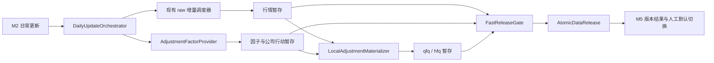

# 日常增量市场数据流水线设计与迁移边界

设计日期：2026-08-20  
状态：`待人工批准后实施`  
适用范围：本地、非商用 A 股日频研究数据

## 1. 设计结论

`已确认`：当前三口径逐证券远程同步已完成一次真实发布闭环，但不适合作为日常更新机制。

目标流水线固定为：

```text
参考数据预检
  -> raw 增量远程获取
  -> 公司行动 / 复权因子增量
  -> qfq / hfq 本地派生或变化范围物化
  -> 分钟级快速质量门禁
  -> 同一事务合并规范事实并发布一个数据版本
  -> 用户在 M5 人工决定是否切换默认研究版本
```

本设计保留现有 SQLite、任务状态机、失败重试、质量治理、数据版本和页面结构；不引入新依赖，不修改回测读取接口，不立即删除 raw/qfq/hfq 既有数据。

## 2. 当前链路考古结论

### 2.1 已确认事实

- `data_platform/a_share_sync_scheduler.py`
  - 当前工作项主键为 `job + symbol + adjustment`。
  - `raw/qfq/hfq` 分别生成远程请求，并分别调用 provider 的 `sync_symbol`。
  - 60 RPM 下，单口径 5545 个证券的理论请求下限约 92 分钟。
  - 行情写入完成后才运行快速质量门禁和数据版本发布。
- `data_platform/providers/akshare_a_share_provider.py`
  - 当前 provider 把复权口径直接传给 AKShare / 新浪 / 东方财富行情接口。
  - 当前没有独立的 A 股复权因子 provider 契约。
- `data_platform/a_share_context_backfill.py`
  - 当前 `price_adjustment_factors` 由 `adjusted.close / raw.close` 反推。
  - 该表记录的是既有复权行情的观察比例，不是独立于 qfq/hfq 的上游事实。
  - 因此它不能反向作为本地派生 qfq/hfq 的权威输入，否则形成循环证明。
- 正式库只读核查：
  - `observed_qfq_close_ratio`：10,822,681 行，截止 2026-07-24。
  - `observed_hfq_close_ratio`：10,831,169 行，截止 2026-07-24。
  - 两类因子均早于行情最新日期 2026-08-17。
  - `corporate_action_events` 当前只表达现金分红、送股、转股等字段，尚不足以证明覆盖配股、合并拆分和所有供应商复权规则。
- 当前版本发布事务只原子切换 manifest；行情物理行在发布前已进入规范表。
  - 对“新一轮发布”的可见性尚未做到物理原子隔离。
  - 历史版本仍是清单冻结，不是完整物理快照。
- 现有页面已具备可复用能力：
  - 零写入预览、工作量估算、进度、失败与重试；
  - M3 质量扫描与纠错；
  - M5 版本查看和人工默认版本切换。

### 2.2 当前链路不能直接延续的部分

- 不能继续把 qfq/hfq 当作两个全市场远程行情任务。
- 不能把 `adjusted.close / raw.close` 代理因子升级为全局权威因子。
- 不能只发布新 manifest，却让未通过门禁的新物理行提前被无版本查询读到。
- 不能把完整统一正式验证放入日常更新主链。
- 不能在因子来源、字段和授权未确认时，从公司行动记录自行声称得到权威复权结果。

## 3. 本地参考实现比较

| 参考对象 | 已确认能力 | 采纳结论 |
| --- | --- | --- |
| 当前 SleeperCloudQuant | 持久任务、断点、重试、隔离、快速门禁、版本发布、M2/M3/M5 页面 | 保留并组合，不重写 |
| SleeperCloudQuant-old | raw/qfq/hfq 分表、逐证券 AKShare 下载 | 仅作为反例和兼容来源，不复用同步模式 |
| RQAlpha | raw bars 与累计除权因子分离；按基准日归一化前复权；价格乘因子、成交量使用独立语义 | 只借鉴语义，不复制源码；其许可证含商业用途限制 |
| Lean | raw 与公司行动 factor file 分离；价格因子、拆分因子和参考价显式建模 | 借鉴数据边界与事件证据；不引入 C# 实现 |
| AKShare 1.18.64 | 本地安装版本的新浪 A 股接口支持 `qfq-factor` / `hfq-factor`；分红配送有批量报告期和单股明细接口 | 仅作为待探测候选 adapter；免费访问不等于授权或 SLA |
| vn.py / Backtrader | 本轮未发现可直接解决 A 股复权因子增量的本地能力 | 本阶段不使用 |

架构裁决：

- 核心域自行实现小型复权契约和派生器。
- 外部 provider 只返回来源原生因子与证据，不把供应商字段直接暴露为全局标准。
- RQAlpha / Lean 只提供语义参考，不形成新的运行时依赖。

## 4. 目标模块边界



### 4.1 DailyUpdateOrchestrator

职责：

- 冻结目标交易日、股票池、数据源路由、算法版本和预计工作量。
- 串联各阶段，不直接承担 provider 或 SQL 派生逻辑。
- 汇总远程请求数、本地派生行数、失败证券、重试和发布时间。
- 只有所有门禁通过才调用原子发布。

### 4.2 RawIncrementalStage

- 复用现有 `AShareSyncScheduler` 的任务拆分、限频、重试和停牌处理。
- 固定只请求 `raw`。
- 增加 `release_policy=deferred`，子任务完成后不自行发布版本。
- 结果先写任务暂存区，不直接覆盖正式行情。

### 4.3 AdjustmentFactorStage

- provider 输出来源原生 factor point、语义、观察时间、可得时间、载荷哈希和授权边界。
- 公司行动用于变更发现和审计，不自动等价为完整复权因子。
- 优先只刷新：
  - 新上市证券；
  - 自上次 factor snapshot 后出现公司行动或因子版本变化的证券；
  - 人工指定重拉证券。
- 若候选上游不能提供可靠的变化发现，只允许退回“全市场因子探测”，不得静默使用旧因子派生新行情。

### 4.4 LocalAdjustmentMaterializer

- 输入只允许：同一任务的 raw 暂存、已通过的 factor snapshot、冻结算法版本。
- 输出 qfq/hfq 暂存行和逐行证据引用。
- 对无因子变化证券只派生新增交易日。
- 对因子变化证券：
  - qfq 可能需要重物化该证券的完整历史区间；
  - hfq 只重物化受事件影响的日期范围，最终范围由 factor 语义决定。
- 第一阶段继续物化 qfq/hfq，保持现有读取和回测接口兼容；按需读取作为后续演进项。

### 4.5 FastReleaseGate

日常门禁只覆盖数据发布必要条件：

- 请求股票池与暂存覆盖一致；
- 自然主键无重复；
- raw 和派生 OHLC 合法；
- raw、qfq、hfq 的交易日集合一致，明确停牌除外；
- factor 为正、无缺口、无未来可得记录；
- 派生公式抽样和全量结构一致；
- 交易日历、交易状态和沪深 300 覆盖目标日；
- 版本成员与提交后的物理摘要预计算一致；
- M3 当前没有阻断问题、待发布 overlay 或待复检 remediation。

完整 `scripts/run_formal_verifications.py` 仍只用于代码、结构或配置发布前工程回归。

### 4.6 AtomicDataRelease

- raw、factor、qfq、hfq 在任务期写入带 `job_id` 的暂存表。
- 门禁通过后，在同一个 SQLite 写事务内：
  1. 合并 raw；
  2. 合并 factor snapshot；
  3. 合并 qfq/hfq 变化范围；
  4. 写质量报告；
  5. 生成版本成员；
  6. 将上一版本标记为 superseded；
  7. 创建唯一 published 版本；
  8. 标记父流水线 published。
- 任一步失败则整体回滚，旧规范事实和旧 published 版本保持可见。
- 默认研究版本不自动切换。

## 5. 因子与派生契约

### 5.1 FactorPoint 候选契约

```json
{
  "factor_snapshot_id": "...",
  "symbol": "000001",
  "effective_date": "2026-08-17",
  "available_at": "2026-08-17",
  "factor_semantics": "vendor_hfq_multiplier",
  "factor_value": 1.0,
  "base_date": "2026-08-17",
  "source": "...",
  "source_version": "...",
  "source_payload_hash": "...",
  "quality_status": "candidate|passed|rejected",
  "evidence": {}
}
```

`factor_semantics` 必须显式区分：

- `vendor_hfq_multiplier`
- `vendor_qfq_divisor`
- `canonical_cumulative_multiplier`
- `observed_adjusted_close_ratio`（只允许兼容审计，不允许生产派生）

### 5.2 派生公式候选

若试点确认来源因子可规范化为累计乘数 `F(t)`：

```text
hfq_price(t) = raw_price(t) * F(t) / F(origin)
qfq_price(t) = raw_price(t) * F(t) / F(base_date)
```

其中：

- `origin`、`base_date` 和舍入规则必须进入算法版本。
- OHLC 使用同一日因子。
- 第一阶段为兼容现有系统，volume、amount、turnover_rate 保留 raw 语义，不擅自使用 RQAlpha 的反向成交量调整。
- amplitude、change_amount、change_pct 从派生后的 OHLC / 前收重新计算，不能照抄 raw 或供应商值。
- 公式在正式采用前必须通过供应商 qfq/hfq 对照试点；不满足恒等关系时门禁关闭，不能用容差掩盖系统性差异。

### 5.3 因果边界

- factor point 必须保存 `available_at`，禁止使用决策时点之后才可得的公司行动或更正。
- qfq 的基准日必须绑定数据版本，不允许查询时隐式改为“今天”。
- 策略预检必须展示：数据版本、factor snapshot、base_date、算法版本和评价区间。
- 对价格绝对值敏感的策略，必须显式接受复权基准语义；未确认时优先使用 raw 或比例型特征。

## 6. 数据模型迁移边界

建议只增不改，新增以下实体：

- `market_daily_update_jobs`
  - 父流水线状态、当前阶段、目标日、预计/实际远程请求、预计/实际本地行数、质量报告和发布版本。
- `market_daily_update_stages`
  - `reference/raw/factor/materialize/quality/release` 的状态、进度、错误和开始结束时间。
- `market_daily_price_staging`
  - 带 `job_id` 的 raw/qfq/hfq 待发布行。
- `market_adjustment_factor_snapshots`
  - snapshot 身份、来源、观察日、as-of 日、语义版本、状态和内容哈希。
- `market_adjustment_factor_points`
  - snapshot、证券、生效日、可得日、factor 语义和值及证据。
- `market_adjustment_factor_staging`
  - 当前任务待发布 factor point。
- `market_materialization_items`
  - 证券、口径、重物化范围、原因、行数和错误。

兼容约束：

- 保留 `market_daily_prices` 的现有主键和读取 API。
- 保留现有 `market_incremental_sync_jobs/items`，增加可选 deferred release 语义，旧任务默认行为不变。
- 保留 `price_adjustment_factors` 作为历史兼容表；新生产链不读取 `observed_*_close_ratio` 作为权威输入。
- 不回写旧数据版本，不删除历史三口径数据。
- schema migration、正式数据回填和清理旧任务均须单独授权。

## 7. 页面能力

### 7.1 普通用户入口

M2 新增“日常更新”父流水线卡片：

- 目标交易日和当前默认版本；
- 远程 raw 请求数；
- 因子探测 / 更新证券数；
- qfq/hfq 新增行与重物化行估算；
- 按 60 RPM、历史实测吞吐分别展示理论下限和保守预计耗时；
- 六阶段进度、失败证券、失败阶段和仅失败重试；
- 快速门禁结果和发布版本。

M3：

- 日常快速门禁独立于全量质量扫描；
- 展示 raw/factor/derived 三类问题及可执行修复动作。

M5：

- 展示 factor snapshot、派生算法版本、base_date、原子发布结果；
- 默认版本仍由用户二次确认切换。

策略预检：

- 显示 raw/factor/qfq/hfq 覆盖交集；
- 显示 factor snapshot 可得性和因果门禁；
- 缺因子、未来可得或派生版本不匹配时失败关闭。

所有行列表继续使用 `web/vtable-adapter.js`，页面继续使用量化 UI Token。

### 7.2 管理员入口

- 完整工程验证放在独立管理员页或 CI，不与“日常更新”按钮相邻。
- 只允许预定义验证集合，不提供任意脚本执行。
- 展示执行环境、脚本清单版本、进度、首个失败、完整日志和历史结果。

## 8. 分阶段实施

### P0：零正式写入因子能力探测

- 对 2 个无近期公司行动证券、2 个有现金分红证券、2 个送转证券、1 个特殊证券执行只读因子探测。
- 核对字段、日期、factor 方向、base_date、可得时间、限频和来源证据。
- 与当前供应商 qfq/hfq 做公式对照，不写正式数据库。

退出条件：无法得到稳定因子或授权边界不清时停止，不进入 P1。

### P1：隔离库本地派生试点

- 新增 factor adapter、规范化器和派生器，但只写隔离测试库。
- 覆盖无公司行动、现金分红、送转、上市不足一年、停牌和退市边界。
- 验证幂等、重跑、舍入、变化范围和因果门禁。

### P2：父流水线与暂存原子发布

- 新增父任务、阶段表、暂存表和 deferred raw 子任务。
- 在复制的规范库或专用候选库完成一次全链路发布演练。
- 执行专项测试和一次统一正式验证。

### P3：正式库灰度

- 用户在页面选择小范围证券执行正式灰度。
- 与旧远程 qfq/hfq 结果并行比较，不自动替换默认版本。
- 人工验收后才允许全市场日常模式。

### P4：存储演进

- 评估停止长期全量物化 qfq/hfq、按需派生或按变化分区物化。
- 引入内容寻址 / 差异快照、修正覆盖层和备份保留策略。
- 本阶段不属于首轮实现范围。

## 9. 回退方案

- 新流水线失败：不合并暂存数据，不生成版本，继续使用旧默认版本。
- 因子源失败：允许 raw 暂存保留待重试，但禁止单独发布“不含匹配 factor”的新版本。
- 派生不一致：保留证据并回到旧三口径人工同步入口；不得修改门禁阈值强行通过。
- 正式灰度失败：禁用新父流水线入口，旧调度器和现有读取接口保持可用。
- 不通过删除、回滚旧表或重置数据库实现回退。

## 10. 待人工批准事项

以下属于结构性和数据语义决策，实施前必须确认：

1. 批准新增父流水线、暂存表和 factor snapshot 表，但保留现有表/API。
2. 批准以本地安装 AKShare 的新浪 factor 接口作为 `P0 候选探测源`；探测通过不自动等于生产授权。
3. 批准首轮继续物化 qfq/hfq，以兼容当前回测和页面；按需派生延后。
4. 批准 volume、amount、turnover_rate 首轮保持 raw 语义，价格衍生字段重新计算。
5. 批准发布成功后仍由用户在 M5 人工切换默认版本。
6. 批准先执行 P0/P1，不直接在 18GB 正式库实施 schema migration 或全市场派生。

## 11. 发布判断

### 已验证项

- 当前三口径远程同步瓶颈、任务状态机、发布门禁和页面能力已经源码取证。
- 当前 factor 表的循环依赖和日期滞后已经正式库只读取证。
- 本地 AKShare 安装包存在独立因子候选接口，但尚未执行网络探测。
- RQAlpha / Lean 的 raw + factor 分离语义可作为设计参考，不需要引入依赖。

### 未验证项

- 候选因子接口的真实返回、长期稳定性、限频和数据授权。
- 因子规范化公式与当前供应商 qfq/hfq 的全边界一致性。
- SQLite 同事务合并在最大变化日的实际耗时和 WAL 空间。

### 阻塞原因

- 新表、发布事务改造和正式灰度属于结构性改动，需要人工批准。
- 权威 factor 来源尚未完成 P0 只读能力探测。

### 潜在风险

- 前复权基准变化会导致有公司行动证券的历史 qfq 重物化。
- 当前历史 raw/qfq/hfq 混合了 legacy 与新 provider，不能直接作为绝对真值。
- 公司行动字段不完整时自行推导 factor 会产生看似一致但不可审计的数据。
- 大事务需要预估 WAL 空间并设置失败回滚证据。

### 发布判断

`可进入 P0/P1，尚不可直接改造正式日常更新主链。`
