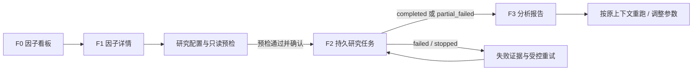

# 阶段 87：独立因子分析功能设计提案

## 0. 文档状态

- 状态：`已批准并按 87.0 → 87.1 → 87.2 实施`。
- 日期：`2026-08-12`。
- 初稿边界：先完成项目盘点、外部产品取证与产品/交互/技术方案设计；后续实施以用户批准为门禁。
- 实施门禁：用户已于 2026-08-12 确认按 87.0 → 87.1 → 87.2 顺序实施；阶段 D 未同时启动。
- 附件边界：本次会话未暴露一份可单独读取的新 PDF/DOCX/图片附件；当前可见的内部设计依据是 `docs/interaction/stage-86-data-center-factor-mvp.md`。若用户所说附件是另一份文件，需补充后再冻结本提案。

## 1. 当前项目状况

### 1.1 已确认的项目与工作区状态

- 提案时项目阶段：`stage-86-data-center-upgrade-stage-c-completed`；当前阶段 87 已获批准并完成代码闭环。
- 当前分支：`agent/stage-76-10-github-sync`，相对远端同名分支领先 3 个提交。
- 工作区：只有未跟踪的 `var/` 运行数据；本轮不覆盖、不清理、不提交该目录。
- 当前本地服务：`http://127.0.0.1:8010` 可读，数据中心和历史因子 API 均在运行。
- 已具备的可复用底座：数据中心 M0—M5、SQLite 持久任务模式、不可变数据版本与质量报告、点时行业区间、Quant UI Standard、VisActor VTable 1.23.1、回测与报告的证据化展示模式。

### 1.2 当前数据版本事实

| 项目 | 当前值 | 设计含义 |
| --- | --- | --- |
| 数据中心默认指针 | `scq-20260724-06a16f4a9fb078d9` | 状态已经是 `superseded`，截止 `2026-07-24` |
| 最新 `published` 版本 | `scq-20260810-29d6940cd8820c57` | 截止标记为 `2026-08-10`，但并非默认指针 |
| 最新版本 raw/qfq 行情 | 到 `2026-08-10` | 不能据此推断所有研究依赖都到 8 月 10 日 |
| 最新版本 hfq 行情 | 到 `2026-07-30` | 不同复权口径覆盖不一致 |
| 公司行动、交易状态、复权因子 | 到 `2026-07-24` | 依赖这些事实的研究有效截止日仍受 7 月 24 日约束 |
| 生命周期事件 | 到 `2026-07-16` | 点时股票池预检必须披露该证据边界 |

结论：研究任务不能只看 `data_versions.as_of_trade_date`。必须按所选因子、股票池、复权/收益口径和预处理依赖，计算各必需数据集覆盖区间的交集，并把 `requested_range` 与 `effective_range` 同时展示。

### 1.3 当前因子功能代码地图

```text
web/index.html + web/app.js
  -> GET /api/factors/*（6 条只读路由）
  -> app/services/factor_research_service.py
  -> factor_lab/registry.py（2 个内置因子）
  -> factor_lab/calculators/price_factors.py
  -> tmp/formal_http_demo.sqlite3.factor_result_cache
```

当前能力：

- 2 个内置因子：`close_to_close_return_1d`、`close_to_ma2_bias`。
- 支持单标的计算、股票列表串行计算、读取因子值、截面摘要和 Top N。
- 两个因子均通过旁路契约绑定 `a_share_daily.close`，默认 `raw`、`as_of_trade_date`。
- 历史 `/api/factors/*` 只有读取接口；没有研究任务创建、预检、进度、报告或重试接口。
- Web 页面仍使用固定的 `2020-01-02` 示例日期，并把 JSON 直接放在 `<pre>` 中。

当前阻断问题：

1. `app/runtime/demo_registry.py` 启动时仍向 `tmp/formal_http_demo.sqlite3` 写入 2020 年两只演示股票的因子结果。
2. 当前 8010 运行态查询 `000300.XSHG + 2026-07-24`，实际返回 `000001.XSHE`、`600000.XSHG` 两只演示成员；不能作为真实点时沪深 300 股票池。
3. 数据集目录将 `index_components` 标成 `connected`，但规范行情库没有可见的点时指数成分事实表，当前正式读取链也没有落到该事实层。
4. 当前因子缓存主键未包含 `factor_version`、`data_version_id`、参数 hash、股票池快照或预处理 hash，无法证明跨任务可复现。
5. 当前计算为逐标的串行调用，普通页面加载也会触发因子服务初始化与演示计算，不适合全市场长周期研究。
6. 当前没有 IC/Rank IC、ICIR、覆盖、分布、行业 IC、分组收益、换手、衰减、显著性、失败样本和证据等级。

因此，当前“因子分析”是可验证的早期演示垂直切片，不是可用于正式本地研究的独立因子流水线。

## 2. 聚宽参考取证与采纳边界

### 2.1 已确认的聚宽因子看板结构

来源：[聚宽因子看板](https://www.joinquant.com/view/factorlib/list)、[公开设置接口](https://www.joinquant.com/factorlib/index/getSetting)、[公开分类接口](https://www.joinquant.com/factorlib/index/getFctCategoryList)。

- 筛选维度：因子分类、股票池、回测周期、组合构建；页面代码还包含手续费/滑点和涨停/停牌过滤设置。
- 股票池设置包含沪深 300、中证 500、中证 800、中证 1000、中证全指。
- 周期设置包含近 3 个月、1 年、3 年、10 年。
- 组合结构包含纯多头、最高分位做多/最低分位做空及其反向组合。
- 列表按所选组合模式展示并可排序：最小/最大分位年化或超额年化收益、最小/最大分位换手率、IC 均值、IR。
- 点击因子名称进入带同一研究上下文的详情页。

### 2.2 已确认的聚宽因子详情结构

来源：[用户给定的聚宽因子详情页](https://www.joinquant.com/view/factorlib/detail/8f2e6b764f52b1313bb0d75f3e6a2463?buildtype=0&universetype=eno1MDA%3D&period=M3k%3D&commisionFee=MA%3D%3D&skipPaused=MQ%3D%3D)。

- 因子元数据：中文/英文名、类别、计算公式、更新时间、数据处理方法和默认参数。
- 研究参数：组合构建、股票池、回测区间、停牌/涨停过滤、调仓周期、调仓时间、手续费和滑点。
- 首屏统计：IC 均值、`|IC| > 0.02` 比率、IR。
- 收益风险：累计收益、年化收益、超额年化收益、基准年化收益、最大回撤、夏普和换手率。
- 图表：分位/多空累计收益、IC 与 22 日均线、行业 IC、换手率、买入信号衰减。
- 截面明细：最新一期因子值最大和最小的股票列表。

### 2.3 采纳与不采纳

| 维度 | 采纳 | 不直接采纳 |
| --- | --- | --- |
| 信息架构 | 看板筛选与横向比较、因子详情、任务上下文联动 | 复制聚宽视觉样式或前端代码 |
| 指标 | IC/Rank IC、分组收益、换手、衰减、极值股票 | 未披露公式版本、样本门槛或缺失原因的单一数字 |
| 组合 | Q1—Q5、Top-Bottom、基准与多空视图 | 把因子研究收益等同于可交易策略收益 |
| 数据 | 股票池和周期可切换 | 使用当前成分回填历史、使用外部实时计算替代本地版本绑定 |
| 运行 | 同一上下文从看板进入详情 | 在普通页面请求中同步执行全市场长任务 |
| 产品边界 | 因子值极值和解释入口 | 开放任意 Python 因子代码执行 |

本项目的差异化重点不是“做出另一个聚宽页面”，而是补齐本地数据版本、点时股票池、质量证据、任务可恢复和结论边界。

## 3. 产品定位与范围

### 3.1 任务目标

建设一个本地、版本化、可复现的独立因子研究工作台，让用户可以：

1. 在统一研究上下文下筛选和比较因子。
2. 查看因子定义、依赖、可用区间与历史研究结果。
3. 经预检后创建持久化研究任务。
4. 查看 IC、Rank IC、分组收益、换手、衰减、覆盖与失败证据。
5. 用同一个 `task_id/report_id` 复现研究，不把策略暴露分析冒充独立因子研究。

### 3.2 本轮明确不做

- 不开放任意 Python 因子执行、上传代码或不受控表达式。
- 不接入付费数据源，不承诺免费上游 SLA。
- 不在页面请求中触发外部同步、全市场重算或数据版本发布。
- 不把阶段 79—85 的策略原始信号/目标权重/持仓暴露结果改名为因子结果。
- 不首期实现财务、Alpha、完整风格风险模型和市值中性化；对应点时事实尚未闭环。
- 不承担实盘选股、自动下单或确定性投资建议。

### 3.3 关键术语

- `FactorDefinition`：受控因子的身份、版本、公式、方向、参数 Schema、数据依赖与可用时间规则。
- `ResearchContext`：因子版本、数据版本、点时股票池、期间、未来收益周期、调仓、分组、预处理和成本假设的不可变组合。
- `ContextHash`：上述研究上下文的稳定 hash；看板只能复用完全相同上下文的报告。
- `PointInTimeUniverse`：按每个研究截面当时有效事实得到的股票池，不使用今天的成分回填历史。
- `EvidenceLevel`：`complete / partial / unavailable`，由依赖覆盖、样本、失败和统计门槛共同决定。
- `IndependentFactorResearch`：抽象因子值与未来收益的横截面关系；与策略暴露分析保持独立命名和输入证据。

## 4. 用户流程与信息架构



因子分析保持主导航一级入口，内部使用：

- `因子库`
- `因子开发`
- `因子研究`
- `研究任务`
- `研究报告`
- `多因子研究`
- `因子发布与应用`

因子详情作为因子库内的上下文弹窗；研究报告因承担研究任务的正式结果阅读，保留独立二级菜单、来源任务说明和返回入口。全局标题随二级页面更新，因子模块不再重复展示“因子分析工作台”标题面板或额外状态区块。

### 4.1 F0 因子看板

#### 研究上下文栏

- 数据版本：明确显示状态、截止标记和“各依赖共同有效截止日”。
- 股票池：P0 仅开放已通过点时预检的股票池；不可用池保留禁用项和原因。
- 研究期间：自定义起止日期，并提供近 3 月/1 年/3 年/10 年快捷项。
- 未来收益周期：1/5/10 个交易日。
- 调仓周期：1/5/10/20 个交易日。
- 分组：5 组为默认，10 组为可选。
- 预处理方案：无处理、标准方案、自定义顺序。
- 搜索与分类：价格、收益、成交量、成交额、波动、动量、技术。

#### 指标卡

- 当前匹配的因子数。
- 已有完全匹配报告的因子数。
- 数据共同有效截止日。
- 存在部分证据/失败报告的数量。

#### 因子列表（VisActor VTable）

| 列 | 说明 |
| --- | --- |
| 因子 | 名称、版本、分类、方向 |
| 证据 | complete / partial / 未计算 |
| 覆盖率 | 有效因子值数 / 应有观察数 |
| Rank IC 均值 | 精确上下文下的完成报告值 |
| Rank ICIR | 非年化值；年化值单独标识 |
| 正 Rank IC 比率 | `RankIC > 0` 的有效截面比例 |
| Q5-Q1 年化收益 | 始终表示高因子值组减低因子值组 |
| 最大回撤 | 对应 Q5-Q1 累计序列 |
| 分组换手 | 显示所选组或高/低组 |
| 样本 | 有效截面数、股票—日期观察数 |
| 更新时间 | 报告完成时间，不是上游数据更新时间 |

规则：

- 只有 `ContextHash` 完全一致的报告才能进入同一张看板比较。
- 没有报告显示“未计算”，缺失指标显示 `— + reason`，不得显示 0。
- 点击行进入 F1；支持按上述指标排序。
- P1 可增加“选中最多 4 个因子对比”，不进入首期阻断范围。

### 4.2 F1 因子详情与研究配置

#### 因子身份区

- 中文名、英文/技术 ID、分类、版本、方向和状态。
- 公式/实现摘要、参数及默认值。
- 所需数据集、字段、最少回看期、点时策略和可用时间规则。
- 定义 hash、实现版本、最近一次完成报告及其数据版本。

#### 配置区

- 数据版本与复权/收益口径。
- 点时股票池与基准。
- 起止日期、未来收益周期、调仓周期、分组数。
- 缺失处理：剔除为默认；不做均值静默填充。
- 缩尾：默认 `MAD 3`，可关闭。
- 标准化：默认 z-score，可关闭。
- 行业中性化：仅在点时行业覆盖通过时可用；P0 默认关闭。
- 处理顺序：默认 `缺失过滤 -> 缩尾 -> 标准化 -> 行业中性化`，实际顺序写入任务快照。
- 交易可用性：按 `trading_status` 过滤停牌/不可交易观察；不从缺少行情推断停牌。
- 成本方案：P0 只展示研究毛收益；P1 才开放带手续费/滑点的执行估算，并与 IC 口径分区展示。

#### 只读预检

`预检` 不写研究库，不触发外部同步，返回：

- 请求区间与各依赖共同有效区间。
- 预计交易日、截面、股票—日期观察数和缓存命中率。
- 股票池是否为真实点时事实、快照来源和可复现 hash。
- 因子所需回看期与未来收益尾部损失。
- 行情、交易状态、生命周期、行业、基准、公司行动等依赖覆盖。
- 幸存者偏差、未来信息、当前成分回填、数据版本状态检查。
- 阻断项、警告项、预计耗时和磁盘增量。

只有无阻断项时才启用“创建研究任务”。

### 4.3 F2 研究任务

- 列表字段：任务名/ID、因子版本、股票池、数据版本、有效期间、状态、进度、有效截面、失败资产、创建/开始/完成时间、耗时。
- 当前任务显示阶段进度：`准备输入 -> 计算因子 -> 截面预处理 -> 计算未来收益 -> 聚合统计 -> 固化报告`。
- 操作由后端 `capabilities` 决定：查看、停止接收新分片、重试失败项、按原配置重跑、查看报告。
- 页面关闭或服务重启后任务状态仍可恢复；不能永久停留在 `running`。
- 删除不进入 P0；如后续增加，只能软删除任务索引，不删除报告和审计事实。

建议状态机：

```text
queued -> running -> completed / partial_failed / failed
                 -> stopping -> stopped
failed / partial_failed / stopped -> retry_queued -> running
```

### 4.4 F3 分析报告

#### 报告封面与证据条

- 因子名称/版本/方向、任务 ID、报告 ID。
- 数据版本、质量报告、股票池快照 hash。
- 请求区间与有效区间、处理方案 hash、统计引擎版本。
- `complete / partial / unavailable` 与直接原因。

#### 报告章节

1. **研究上下文**：公式、参数、股票池、基准、收益周期、调仓、分组、处理顺序。
2. **数据覆盖与分布**：覆盖率、缺失率、有效截面、失败资产、原始/处理后分布与极值。
3. **IC / Rank IC**：均值、标准差、ICIR、t 值/p 值、正值比例、时间序列、滚动均值。
4. **衰减**：1/5/10 期 IC/Rank IC；P1 增加高/低组成员持续性。
5. **行业分析**：点时行业 IC、样本量和缺失行业；行业覆盖不足时禁用而不是回填当前行业。
6. **分组收益**：Q1—Q5、Q5-Q1、方向调整后的优选组差、基准与超额累计序列。
7. **风险与换手**：年化收益、波动、最大回撤、夏普、分组换手；毛收益与成本估算分开。
8. **截面明细**：选择日期后查看因子值最高/最低 N 只股票、处理前后值、所属行业和可交易状态，使用 VTable。
9. **证据缺口与结论边界**：失败资产、缺失字段、质量警告、统计样本不足和“非投资建议”。

图表必须支持亮暗主题，表格统一经 `window.AppVTable`，741px 窄屏不得产生整页横向溢出。

## 5. 统计与金融口径

### 5.1 时间边界

- 因子值在交易日 `T` 的可用时间由 `availability_rule` 决定。
- P0 日频价格因子默认在 `T` 收盘后可用。
- IC 目标为同一证券从 `T` 到 `T+N` 的版本化研究收益；具体收益构造与公司行动处理必须记录 `forward_return_method_version`。
- 因子计算只能读取 `T` 当时已经可用的输入，不得读取 `T` 之后发布的事实。
- 研究收益不是可交易成交收益；下一交易日开盘成交、手续费、滑点和涨跌停约束属于 P1 执行估算层。

### 5.2 截面统计

- `IC`：每个有效截面上，处理后因子值与未来收益的 Pearson 相关。
- `Rank IC`：每个有效截面上，因子秩与未来收益秩的 Spearman 相关。
- `ICIR / Rank ICIR`：`mean / sample_std`；不默认年化。若显示年化值，必须单独命名并披露年化系数。
- 正值比例：有效截面中 `IC > 0` 或 `Rank IC > 0` 的比例。
- 显著性：有效截面数不足门槛时返回 `unavailable + insufficient_cross_sections`。
- 常量截面、有效股票数不足、未来收益缺失时，该截面从相关统计中剔除并计入原因分布。

### 5.3 分组与方向

- `Q1` 固定表示低因子值组，`Q5` 固定表示高因子值组，不随方向改名。
- 原始价差固定为 `Q5 - Q1`。
- 因子方向为负时，可另显示“方向调整后价差”，但不得覆盖原始 Q5-Q1。
- ties 使用稳定秩和确定性二级键分组；分组不足时披露实际组数。
- 默认等权；市值加权在点时市值事实可用前保持禁用。

### 5.4 收益、回撤与换手

- 分组收益先输出每期事实，再由统一版本公式生成累计、年化、波动、夏普与最大回撤。
- Top-Bottom 与基准超额必须声明是毛收益还是成本后估算。
- 组合换手采用 `0.5 * sum(abs(w_t - w_t-1))`；上市、退市、停牌和缺失权重的处理进入公式版本。
- “信号衰减”分成两类：未来收益周期上的 IC 衰减，以及优选组成员随 lag 的持续性；不得混成一个指标。

## 6. 数据能力与阶段门禁

| 能力 | 当前事实 | 阶段 87 处理 |
| --- | --- | --- |
| A 股日线 | 已连接，版本成员存在 | P0 使用；按因子口径选择点时调整视图 |
| 交易日历 | 已连接 | P0 使用 |
| 数据版本/质量 | 已连接 | P0 强绑定 |
| 交易状态 | 有正式事实，当前覆盖到 2026-07-24 | P0 过滤；超出覆盖预检阻断或降级 |
| 生命周期 | 有事实，但有效边界需逐版本核验 | P0 股票池资格依据之一 |
| 公司行动/复权因子 | 有事实，当前覆盖到 2026-07-24 | P0 收益构造和价格连续性证据 |
| 行业分类 | 有点时区间，仍有上游失败历史 | P1；覆盖不达标时禁用行业中性化 |
| 指数成分 | 目录标记 connected，但正式因子读取仍回退演示数据 | 在开放指数池前补齐规范事实表、版本成员和正式读路径 |
| 市值 | 当前无完整点时市值事实 | 市值中性化/市值加权禁用 |
| 财务报表 | disabled | P2，另行审批 |

推荐的 P0 股票池是“全 A 股点时可研究池”：按生命周期、交易状态和必要行情事实逐截面生成。沪深 300/中证系列只有在 `index_components` 的点时事实、版本成员和正式读取链全部验收后开放。

## 7. 技术方案

### 7.1 复用边界

直接复用：

- 数据版本、成员、质量报告和默认/最新版本读取。
- `ClassificationHistoryStore` 的点时行业查询。
- 数据中心/回测已有的 SQLite 持久任务、后台进程、轮询、重启补偿和能力字段模式。
- `FactorRegistry` 和两个现有计算器作为兼容样本。
- Quant UI Token、主题切换、VTable 适配层和现有模态框规范。
- 报告中心的“上下文—事实—分析—缺失证据”展示原则。

只借鉴思想、不复用代码：

- 聚宽的看板筛选、详情指标分区和上下文联动。
- 阶段 79—85 的统计公式可提取为通用纯统计函数，但策略对象、表名、报告标题和 ID 不复用。

保持隔离：

- 历史 `/api/factors/*` 与 `factor_result_cache` 保留兼容读取，标识 `legacy_demo`。
- 新功能只走 `/api/factor-research/*`，不得隐式回退 `DemoMarketDataRepository`。
- 新任务不写规范行情事实表，不改变数据中心版本指针。

### 7.2 建议模块边界

```text
factor_lab/
  registry.py                     # 兼容入口，解析受控因子版本
  definitions.py                  # 因子定义、参数和依赖契约
  input_view.py                   # 版本化、点时、防前视输入视图
  preprocessing.py                # 缺失/缩尾/标准化/中性化
  statistics.py                   # IC、分组、换手、衰减纯函数
  research_engine.py              # 分片研究流水线
  storage/sqlite_research_store.py

app/services/factor_research_task_service.py
app/api/factor_research.py
app/schemas/factor_research.py

web/factor-research.js
web/factor-research.css
```

这是待批准的目录候选，不在本轮创建。

### 7.3 最小 API 契约

- `GET /api/factor-research/definitions`
- `GET /api/factor-research/definitions/{factor_id}`
- `GET /api/factor-research/dashboard?context_hash=...`
- `POST /api/factor-research/preflight`：只读，不落任务。
- `POST /api/factor-research/tasks`
- `GET /api/factor-research/tasks`
- `GET /api/factor-research/tasks/{task_id}`
- `POST /api/factor-research/tasks/{task_id}/stop`
- `POST /api/factor-research/tasks/{task_id}/retry-failed`
- `GET /api/factor-research/tasks/{task_id}/report`

所有响应必须包含：

- `status`
- `capabilities`
- `context_hash`
- `data_version_id`
- `requested_range`
- `effective_range`
- `evidence_level`
- `unavailable_reasons`

### 7.4 增量数据模型候选

沿用阶段 86.0 已冻结的四个概念表，不修改既有事实表：

1. `factor_definitions`
   - 组合主键：`factor_id + factor_version`。
   - 保存名称、分类、方向、参数 Schema、依赖、可用时间规则、实现键、定义 hash、状态和创建时间。
2. `factor_research_tasks`
   - 保存任务状态、进度、配置/上下文 hash、数据版本、范围、计数、时间、能力和结构化错误。
3. `factor_research_snapshots`
   - 保存股票池/依赖/处理/失败摘要的不可变快照与 hash；大规模逐观察值不默认重复持久化。
4. `factor_research_reports`
   - 保存报告版本、公式版本、摘要、序列 payload、证据等级、缺失原因和不可变 hash。

旧 `factor_result_cache` 不原地改 Schema。若 P0 需要可复用原始因子值缓存，新增版本化缓存表或独立数据库，避免污染旧主键语义。

### 7.5 计算流水线

1. 校验因子版本和参数。
2. 解析数据版本并计算所有依赖的共同有效区间。
3. 生成逐截面的点时股票池；禁止 Demo fallback。
4. 按时间/证券分片读取版本成员中的输入事实。
5. 按可用时间规则计算原始因子值。
6. 在每个截面执行冻结顺序的预处理并记录丢弃原因。
7. 计算未来研究收益、IC/Rank IC、分组和换手。
8. 聚合统计并固化报告；报告完成后看板才可读取。

全市场任务必须在后台运行，HTTP 创建请求只负责冻结配置并返回 `task_id`。

### 7.6 安全与完整性

- 因子只从受控注册表解析；不 `eval`、不执行上传脚本。
- 参数按服务端 Schema 校验，日期、分组、窗口和股票池规模有上限与预检。
- 前端对公式、说明和失败证据做 HTML 转义，禁止资源注入。
- 任务创建不触发外部网络同步；缺数据返回 Data Center 下钻链接。
- 任务、报告和导出不得包含密钥、真实环境变量值或上游敏感响应。
- 研究报告必须固定显示非商用、本地研究和非投资建议边界。

## 8. 推荐实施分期

### 87.0 治理与数据就绪

- 确认本提案及下方决策项。
- 冻结统计公式、因子版本和研究收益方法。
- 对齐“默认 superseded 版本”与“最新 published 版本”的新研究默认规则。
- 核验并补齐 `index_components` 正式事实；未完成前指数池保持禁用。
- 为因子研究建立专项验证基线和小型黄金数据集。

### 87.1 P0 独立因子研究闭环

- 受控 P0 因子注册表，首批建议 6 类代表因子：1 日收益、20/60 日动量、20 日波动、20 日均线偏离、量/额相对强度；最终公式逐项冻结。
- 全 A 股点时可研究池。
- 只读预检、持久任务、停止/失败重试、重启补偿。
- 覆盖/分布、IC/Rank IC、1/5/10 期衰减、Q1—Q5、Q5-Q1、回撤和换手。
- 因子看板、详情、任务和报告四个视图。
- 历史 `/api/factors/*` 保持兼容但标记演示边界。

### 87.2 点时股票池与增强分析

- 沪深 300、中证 500/800/1000/全指点时成分。
- 点时行业 IC、行业中性化、成员持续性/信号衰减。
- 因子对比、报告快照/导出。
- 执行估算层：下一可交易时点、手续费、滑点、涨跌停和停牌规则；与研究毛收益分开展示。

### 87.3 后续候选

- 市值中性化和市值加权，前提是点时市值事实通过。
- 财务、质量、成长、风格风险、Alpha 因子，前提是点时财务事实、来源授权和质量门禁通过。
- 受控表达式因子；任意 Python 仍不开放，除非另行安全评审和人工批准。

## 9. 验收标准

### 已验证项要求

- 同一请求在相同因子版本、数据版本和上下文下生成同一 `context_hash` 和报告 hash。
- P0 黄金数据集覆盖 ties、缺失、常量截面、停牌、上市/退市、公司行动和未来收益尾部。
- IC、Rank IC、ICIR、分组、换手、回撤与独立参考实现逐项对账。
- 所有新研究任务都绑定显式版本；禁止 Demo fallback 和未发布观察。
- 看板不混用不同上下文结果，缺失指标不显示为 0。
- 任务重启恢复、停止和失败重试不重复已完成分片。
- 桌面与 741px 窄屏无页面级横向溢出；亮暗主题、VTable 重建和无障碍语义通过。

### 直接回归

- 阶段 86 数据中心 M0—M5。
- 数据版本、质量、默认指针和历史 Run 绑定。
- 历史 `/api/factors/*` 与现有因子 smoke。
- 阶段 79—85 策略暴露报告，确保业务命名和对象仍然分离。
- 三种回测模式、报告中心、Quant UI 和 VTable 全局门禁。

### 发布判断口径

- `可交付`：专项、真实数据小样本、全 A 股受控任务、浏览器和统一回归均通过；数据与统计边界完整披露。
- `可继续迭代`：P0 闭环通过，但指数点时池、行业或执行估算仍待补齐。
- `应先返工`：出现 Demo fallback、数据版本未冻结、未来信息、当前成分回填、指标混用或不可复现。

## 10. 已确认决策与遗留门禁

以下 7 项已随用户批准进入实施；其中正式指数事实和附件差异复审仍受数据门禁约束：

1. **阶段入口**：批准进入阶段 87.0/87.1；不同时启动阶段 D。
2. **版本默认策略**：新研究默认选择“满足全部依赖且质量通过的最新 `published` 版本”；当前 `superseded` 默认版本只用于历史复现，不静默用于新研究。
3. **P0 股票池**：先做全 A 股点时可研究池；中证系列等 `index_components` 正式事实闭环后再开放。
4. **P0 因子范围**：首批只做价格、收益、成交量/额、波动、动量和技术派生因子；财务/市值/Alpha 后置。
5. **收益分层**：87.1 只做明确标注的研究毛收益；执行成交、手续费和滑点进入 87.2。
6. **默认预处理**：`缺失剔除 -> MAD 3 缩尾 -> z-score`；行业中性化默认关闭，待点时行业覆盖通过后启用。
7. **附件补充**：若用户所说附件不是现有 `stage-86-data-center-factor-mvp.md`，补充附件后再做一次差异复审，不直接进入实现。

## 11. 当前结论

- `已确认`：项目已有构建独立因子研究所需的大部分工程底座，但现有因子页和股票池仍是演示链路。
- `已确认`：聚宽的看板/详情信息架构适合作为交互参考，但不能替代本项目的数据版本、点时事实和证据门禁。
- `基于当前上下文推断`：按 87.0 -> 87.1 -> 87.2 分期，能在不引入新框架和不复制第二套任务系统的前提下完成闭环。
- `已确认`：第 10 节产品与技术决策已按顺序实施。`待确认`：正式指数点时成分数据的受控导入，以及若存在额外附件时的差异复审。
