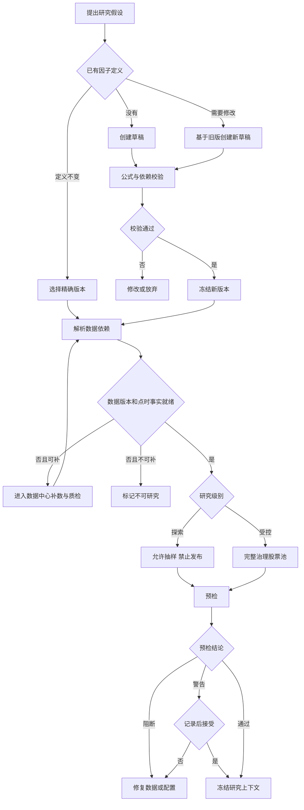
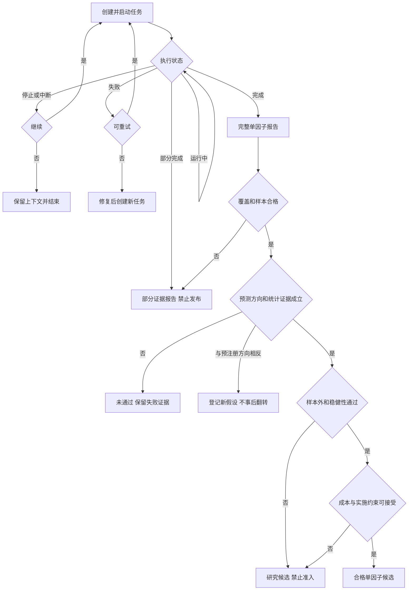
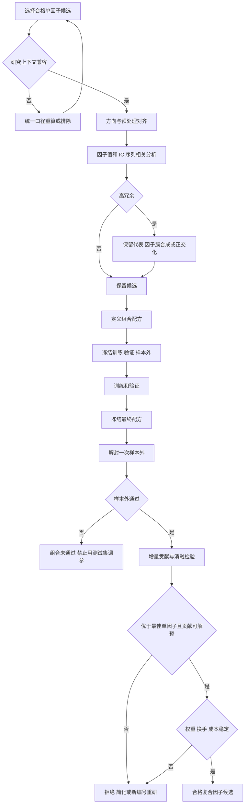
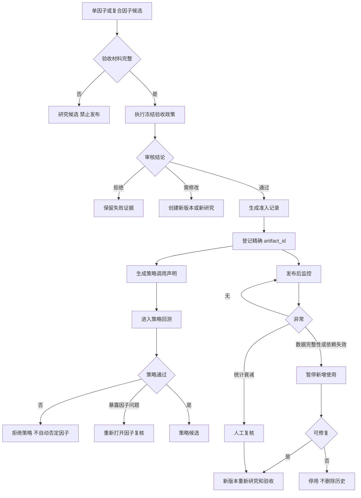

# 因子分析标准业务流程 v1

## 1. 状态

- 状态：已确认，作为单因子、多因子、准入发布和生命周期改造的业务基线。
- 范围：因子定义、数据准入、研究任务、研究报告、复合因子、验收、策略登记和发布后监控。
- 边界：因子研究输出预测信号及历史证据；账户持仓、成交、资金和风险约束继续由策略回测负责。

## 2. 三类判断标准

1. **硬门禁**：数据版本、点时事实、未来信息、不可变版本、研究上下文和可复现性；不满足时必须阻断。
2. **验收政策**：覆盖、样本、Rank IC、显著性、分层收益、成本、稳健性和多因子增量贡献；数值随研究类型配置，并在样本外结果解封前冻结。
3. **观察指标**：用于解释因子，不单独决定准入。

任何受控研究必须绑定一份不可变 `AcceptancePolicy`。探索研究可以试算，但不能进入策略准入。

## 3. 因子定义与数据准入

硬门禁包括：精确因子版本、已发布且质量通过的数据版本、点时股票池、交易状态、生命周期、未来收益覆盖、预处理顺序、成本假设、样本划分和稳定的 `context_hash`。

## 4. 单因子研究

报告至少包含：覆盖与失败原因、原始及处理后分布、IC/Rank IC/ICIR、稳健显著性、Q1—Q5、Top-Bottom、IC 衰减、因子秩自相关、分组成员换手率、行业分析、样本内外、滚动窗口、成本压力和结论边界。

## 5. 多因子研究

首期只允许等权秩组合、固定权重组合和因子簇内等权。动态 IC 权重、回归和机器学习组合不进入首期。

## 6. 准入、发布与监控

## 7. 状态模型

| 对象 | 状态 |
| --- | --- |
| 因子定义 | `draft / frozen / deprecated` |
| 研究任务 | `ready / running / completed / partial_completed / failed / stop_requested / stopped / interrupted` |
| 研究结论 | `complete / partial / unavailable / rejected / candidate` |
| 研究制品 | `research_ready / invalid` |
| 准入审核 | `pending / approved / rejected / revoked` |
| 策略登记 | `unregistered / registered / suspended / deprecated` |

研究完成只生成 `research_ready` 制品；只有 `approved + registered` 的精确制品才允许新策略使用。历史任务和历史制品保留，不自动追随最新版本。

## 8. AcceptancePolicy 合同

政策至少冻结：

- 数据质量、最低覆盖和允许缺失原因；
- 最小有效截面、截面样本和独立调仓期；
- 方向一致 Rank IC、ICIR、正值比例；
- HAC 或块 Bootstrap 及多重检验方法；
- 分层单调性、Top-Bottom 毛收益和成本压力；
- 样本外、滚动窗口、年度、市场阶段和股票池稳定性；
- 多因子相关性处理、增量贡献、消融和权重集中度；
- `approved / candidate / rejected / unavailable` 的决策规则。

数值阈值不得从样本外结果倒推；政策变更必须创建新政策版本和新研究任务。
